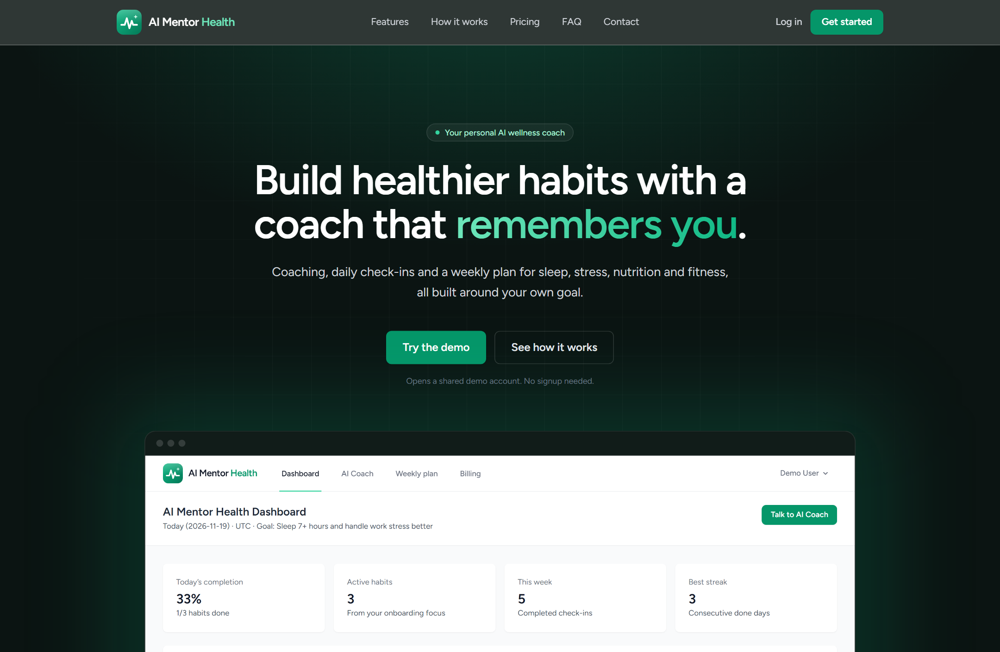
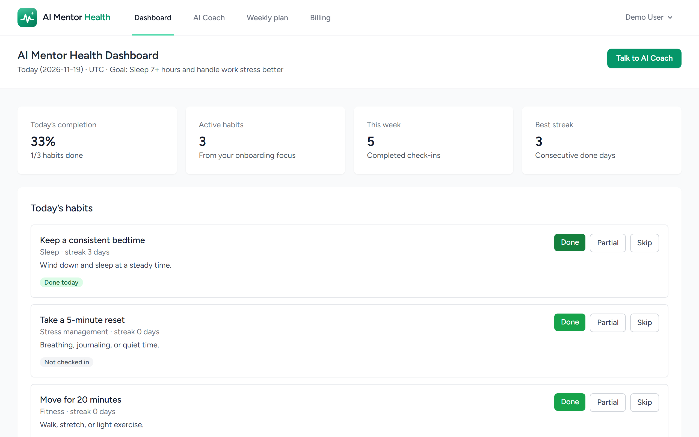
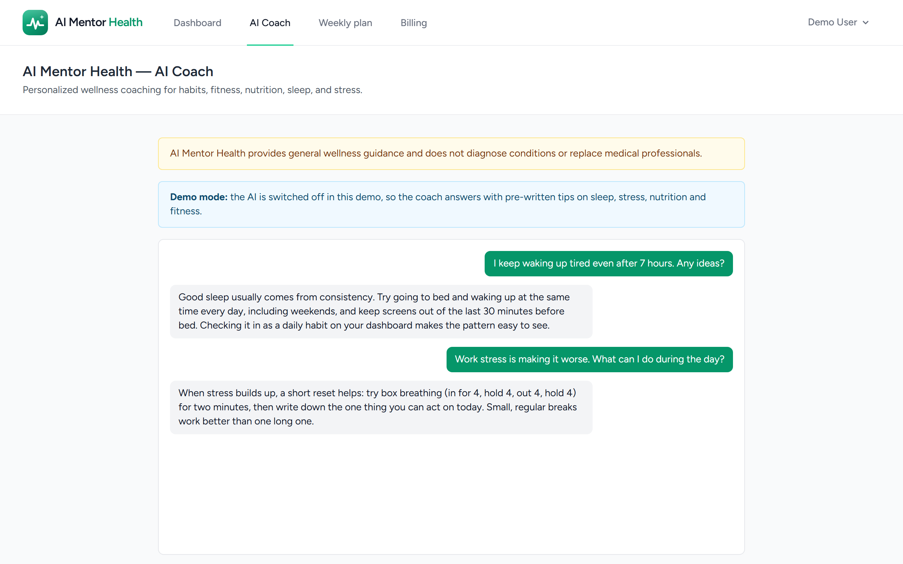
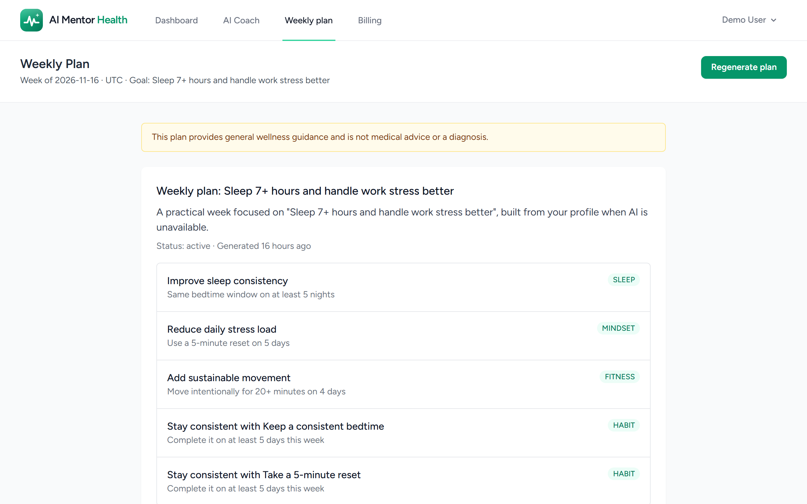
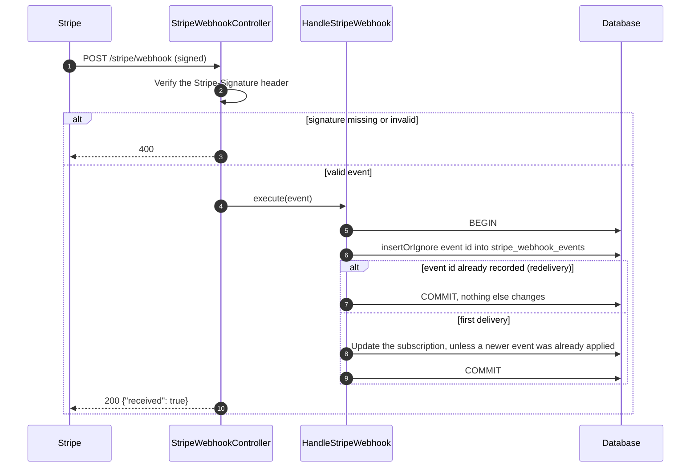
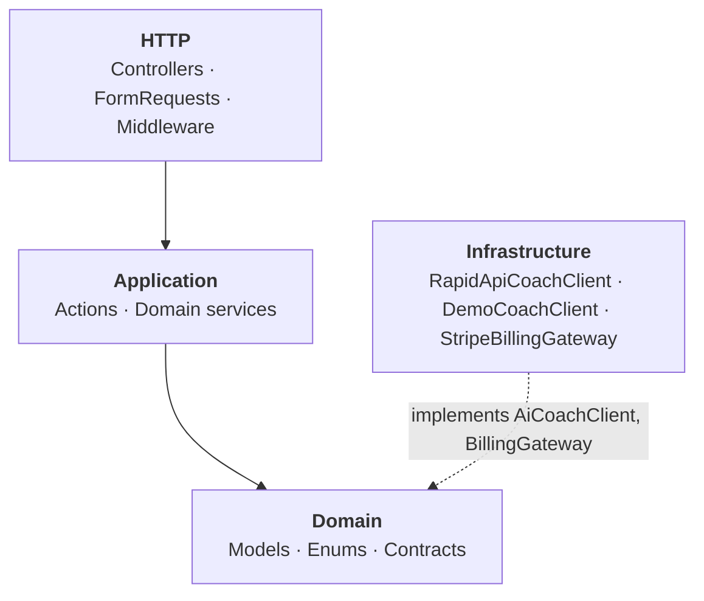

<p align="center">
  
</p>

<p align="center">
  <a href="https://github.com/Shakeelkhan8/ai-mentor-health/actions/workflows/tests.yml"></a>
  
  
  
  
  
  <a href="LICENSE"></a>
</p>

<p align="center">
  A personal AI wellness coach: an AI coach, daily habit check-ins, weekly plans,<br />
  and a Pro subscription through Stripe with per-plan limits.
</p>

<p align="center">
  <a href="#whats-worth-reading"><b>What's worth reading</b></a> ·
  <a href="#screenshots"><b>Screenshots</b></a> ·
  <a href="#how-a-stripe-webhook-is-handled"><b>Webhooks</b></a> ·
  <a href="#architecture"><b>Architecture</b></a> ·
  <a href="#run-it-locally"><b>Run it locally</b></a> ·
  <a href="#tests-and-code-quality"><b>Tests</b></a>
</p>

> [!NOTE]
> AI Mentor Health provides general wellness guidance and does not diagnose conditions or replace medical professionals.

## What's worth reading

The backend parts that are easy to get wrong, each with the tests that pin it down:

| What | Code | Tests |
|------|------|-------|
| **Stripe webhooks safe against redelivery and reordering.** The event id is recorded with `insertOrIgnore` in the same transaction as the change, and an older event can't overwrite newer subscription state. | [`HandleStripeWebhook`](app/Domains/Billing/Actions/HandleStripeWebhook.php) | [`StripeWebhookDeliveryTest`](tests/Feature/Billing/StripeWebhookDeliveryTest.php) |
| **Plan limits decided in one place.** Free users get a daily number of AI messages that resets at midnight in their own timezone; Pro is unlimited. | [`Entitlements`](app/Domains/Billing/Services/Entitlements.php) | [`CoachDailyLimitTest`](tests/Feature/Coaching/CoachDailyLimitTest.php) |
| **AI calls kept out of database transactions.** The provider call holds no locks; if it fails after retries, nothing is saved and no quota is used, and the failure is logged with the user and conversation. | [`SendCoachMessage`](app/Domains/Coaching/Actions/SendCoachMessage.php) | [`SendCoachMessageReliabilityTest`](tests/Feature/Coaching/SendCoachMessageReliabilityTest.php) |
| **Concurrent writes that stay correct on PostgreSQL.** When another request inserts the same day's check-in or the same week's plan first, the losing request updates that row instead of failing, and only one row remains. | Habits and Plans actions | [`ConcurrentWritesTest`](tests/Feature/ConcurrentWritesTest.php) |

CI runs the suite on SQLite and PostgreSQL, plus Larastan (level 5) and Pint, and builds the Docker image, on every pull request.

## Screenshots

<p align="center">
  
</p>

<table>
  <tr>
    <td width="33%" valign="top"><p align="center"><b>Dashboard</b><br /><sub>Daily check-ins, completion and streaks</sub></p></td>
    <td width="33%" valign="top"><p align="center"><b>AI coach</b><br /><sub>Goal-aware chat with saved history</sub></p></td>
    <td width="33%" valign="top"><p align="center"><b>Weekly plan</b><br /><sub>Targets built from goals and check-ins</sub></p></td>
  </tr>
</table>

<sub>Screenshots are from demo mode, where the coach answers with pre-written tips instead of calling an AI provider.</sub>

## How a Stripe webhook is handled



Recording the event id and applying the change in one transaction means a crash between the two can't leave the event marked as done without its change. Comparing the event's creation time with `stripe_event_at` means a late, older event can't roll a subscription back.

## Architecture



The code is split into domains (`Identity`, `Coaching`, `Habits`, `Plans`, `Billing`) under `app/Domains`. Controllers only orchestrate HTTP, actions own the use cases, and domain code depends on contracts, so the AI provider or payment gateway is swapped by rebinding one interface. Feature flags in `config/mentor.php` switch whole modules on and off.

More detail: [docs/architecture.md](docs/architecture.md) and [docs/domains.md](docs/domains.md).

### Product loop

1. **Onboard:** goals, focus areas and timezone; starter habits are created.
2. **Coach:** a goal-aware AI wellness chat with safety framing.
3. **Check in:** daily habit progress, completion and streaks.
4. **Plan:** a weekly plan as strict JSON, with a safe fallback.
5. **Subscribe:** Pro checkout for unlimited coaching, in Stripe test mode.

## Run it locally

Both options start in demo mode: no API keys, a seeded account, and a **Try the demo** button on the login page.

**With Docker**

```bash
docker build -t ai-mentor-health-demo .
docker run --rm -p 8080:8080 -e DEMO_MODE=true -e DB_CONNECTION=sqlite -e DB_DATABASE=/app/database/demo.sqlite -e MAIL_MAILER=log ai-mentor-health-demo
```

Then open http://localhost:8080.

**With PHP 8.2+ and Node.js**

```bash
composer install
npm ci && npm run build
cp .env.example .env
php artisan key:generate
```

In `.env`, set `DB_CONNECTION=sqlite`, `DB_DATABASE` to the absolute path of `database/demo.sqlite`, `DEMO_MODE=true` and `MAIL_MAILER=log`. Then:

```bash
touch database/demo.sqlite
php artisan migrate
php artisan db:seed --class=DemoSeeder
php artisan serve
```

To use a real AI provider, set `DEMO_MODE=false` and `RAPIDAPI_KEY`. For billing, add Stripe test keys.

### Configuration

| Variable | Purpose |
|----------|---------|
| `MENTOR_PRODUCT_NAME` | Product display name |
| `FEATURE_AI_COACH` | AI coach routes |
| `FEATURE_HABIT_TRACKING` | Habit check-ins |
| `FEATURE_WEEKLY_PLANS` | Weekly plans |
| `FEATURE_SUBSCRIPTIONS` | Billing UI |
| `DEMO_MODE` | Pre-written coach replies and the shared demo account |
| `RAPIDAPI_KEY` | AI coach provider |
| `STRIPE_KEY` / `STRIPE_SECRET` | Stripe test keys |
| `STRIPE_WEBHOOK_SECRET` | Webhook verification (required outside local/testing) |
| `STRIPE_PRICE_ID` | Recurring Price id for Pro |
| `FREE_COACH_MESSAGES_PER_DAY` | Free plan's daily AI coach messages (default 10) |

## Tests and code quality

```bash
npm run build      # pages render through @vite, so build assets first
php artisan test
composer lint      # Laravel Pint, style check (run `vendor/bin/pint` to fix)
composer analyse   # Larastan (PHPStan for Laravel), level 5
```

Tests run against in-memory SQLite (configured in `phpunit.xml`), so no database setup is needed. GitHub Actions runs the suite on SQLite and PostgreSQL, Pint, Larastan and a Docker image build on every pull request and on pushes to `main`. Larastan runs with no baseline: findings are fixed, not recorded.

## Deployment

The repository includes a production Docker image and a [Render](https://render.com) blueprint (`render.yaml`) for a free demo in demo mode. Setup and trade-offs: [docs/DEPLOY.md](docs/DEPLOY.md). A 5 to 10 minute walkthrough: [docs/DEMO.md](docs/DEMO.md).

## Pricing model

| Tier | What you get |
|------|----------------|
| **Free** | Onboarding, habit check-ins, weekly plans, and 10 AI coach messages a day |
| **Pro** | Everything in Free, with unlimited AI coach messages |

The daily allowance resets at midnight in the user's timezone and is set by `FREE_COACH_MESSAGES_PER_DAY`. Limits are decided in one place, `App\Domains\Billing\Services\Entitlements`, and are off while `FEATURE_SUBSCRIPTIONS=false`.

## Out of scope

A doctor marketplace, hospital finder, appointments, clinical diagnosis and medical decision support. The earlier doctor, hospital and appointment code was removed rather than kept behind a flag.

## License

The application code in this repository is released under the [MIT License](LICENSE). Composer and npm dependencies, including the Laravel framework, are installed separately and keep their own licenses.
